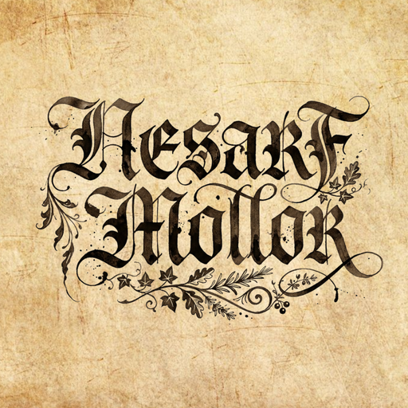

# Nesarf_Mollor

**本文介绍的是同人音乐人 Nesarf_Mollor。**

<table><tr><td width="270" valign="top">

<small>信息栏头像：Vtuber 时期友人所绘</small>

<table border="1" bordercolor="#99CCFF" cellpadding="4" cellspacing="0" width="250">
<tr><th colspan="2" bgcolor="#D6E8FF">基本资料</th></tr>
<tr><td bgcolor="#F0F7FF" width="80"><b>名义</b></td><td>Nesarf_Mollor</td></tr>
<tr><td bgcolor="#F0F7FF"><b>别号</b></td><td>NesarfDX / Nesarf / 南殇芙 / ネサーフ</td></tr>
<tr><td bgcolor="#F0F7FF"><b>身份</b></td><td>Composer / Novelist / 开发者 / 萌百编辑者</td></tr>
<tr><td bgcolor="#F0F7FF"><b>所属团体</b></td><td>聖夢幽庭（S.M.Y.T.）</td></tr>
<tr><td bgcolor="#F0F7FF"><b>音乐社团</b></td><td>CyroNLapheR</td></tr>
<tr><td bgcolor="#F0F7FF"><b>主要曲风</b></td><td>HDM / Rave / Classical / D&amp;B</td></tr>
<tr><td bgcolor="#F0F7FF"><b>独立编曲</b></td><td>自 2014 年 10 月 12 日</td></tr>
<tr><td bgcolor="#F0F7FF"><b>代表曲目</b></td><td><a href="https://music.163.com/#/song?id=2668660970">网易云音乐</a></td></tr>
<tr><td bgcolor="#F0F7FF"><b>活跃平台</b></td><td>X / bilibili / SoundCloud / YouTube</td></tr>
</table>

</td><td valign="top">

## 1 简介

这里是 **Nesarf_Mollor**[[1]](#5-注释)。Composer 与 Novelist：主做流派是 HDM 和 Symphony；写的主要是轻小说和散文。喜欢叙事诗式的风格与沉浸感氛围的音乐[[2]](#5-注释)，2017 年起推 V。

自 2014 年 10 月 12 日起独立做编曲至今。同时使用 DeepSeek 进行工具与程序开发，并以「南殇芙」的名义在萌娘百科编辑条目。隶属于国际研学组织聖夢幽庭（S.M.Y.T.），主理独立音乐社团 CyroNLapheR。

自述：码字的、写曲子的、玩GAL的、看音MAD的、人怪心善。

## 2 曲风

CyroNLapheR 是隶属于聖夢幽庭的独立音乐社团，主打：

- **硬重速**：HDM / Industrial / DnB
- **俱乐部舞曲**：Techno / Trance / Rave
- **传统古典乐**：Classical / Symphony（以 JRPG / Galgame / Anime 风格趋势为导向的世界民族乐）
- 各种注重氛围与能量的中高速（BPM≥135）流派，亦对其他领域有些许涉猎。

## 3 开发

使用 DeepSeek 进行工具与程序开发，主要项目：

- [Himeyuri](https://github.com/Nesarf/Himeyuri) — 通用编程语言 HMYR
- [Yunooka](https://github.com/Nesarf/Yunooka) — 操作系统
- [Hiou-Rengo](https://github.com/Nesarf/Hiou-Rengo) — HIREN 开发平台与 SDK
- [Kohane-Index-Desuno](https://github.com/Nesarf/Kohane-Index-Desuno) — 跨 harness 索引核心（MCP + CLI）
- [mega-index-map](https://github.com/Nesarf/mega-index-map) — 跨工作区 Library 插件
- [volcano-separator](https://github.com/Nesarf/volcano-separator) — 进程守护与系统透明化
- [Ichiwatashi](https://github.com/Nesarf/Ichiwatashi) — 像素画工具
- [AikawaMei](https://github.com/Nesarf/AikawaMei) — 静态与动态安全工具

## 4 文风

轻文学与散文：轻文学以异世界题材为主，散文以景散和抒散为主。偶尔写诗，主要是楚辞和古体四言诗。

## 5 注释

[1] 主做流派是 HDM 和 Symphony。

[2] 主要写的是轻小说和散文。

## 6 外部链接

1. [SoundCloud](https://soundcloud.com/nesarfmollor)
2. [dizzylab（CyroNLapheR）](https://www.dizzylab.net/l/CyroNLapheR/)
3. [Booth](https://nesarfmollor.booth.pm/)
4. [X（Twitter）](https://x.com/Nesarf_Mollor)
5. [bilibili](https://space.bilibili.com/11247581)
6. [网易云音乐](https://music.163.com/#/artist?id=37459218)
7. [DLsite（CyroNLapheR）](https://www.dlsite.com/home/circle/profile/=/maker_id/RG01045755.html)
8. [YouTube](https://www.youtube.com/@NesarfMollor)
9. [萌娘百科（南殇芙）](https://zh.moegirl.org.cn/User:%E5%8D%97%E6%AE%87%E8%8A%99)

</td></tr></table>

---

**分类**：同人音乐人 / 程序员 / 萌娘百科编辑者

本页面最后修改于 GitHub 提交时自动更新

